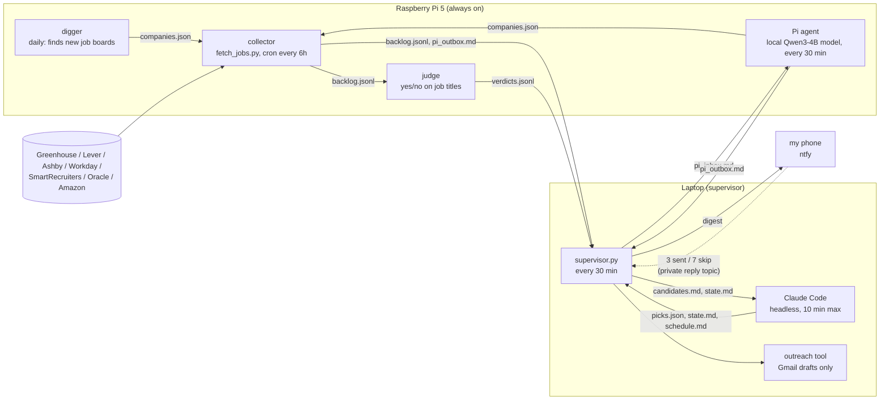

# job-agent

A small multi-agent system that finds internship and early-career roles for me, picks the ones that
actually fit my background, drafts outreach emails and pings my phone with a daily shortlist.

Two LLM agents (Claude and a small model on a Raspberry Pi) plus plain scripts, talking through files, with one human in charge:



| Agent | Runs on | Job |
|---|---|---|
| **Collector** | Raspberry Pi | Pulls public job-board APIs every 6 hours, keeps new India / remote roles (only internships, with `internships_only` in its company list). Keeps working while the laptop is off. |
| **Pi agent** | Raspberry Pi, local LLM | Reads Claude's requests ("add Meesho, drop Druva"), turns them into actions with a small local model (Qwen3-4B-Instruct via llama-server), and replies. Code checks every action: a company is added only if a real public board with jobs exists. It can never touch code. |
| **Digger** | Raspberry Pi, code + local LLM | Finds job boards the company list does not know, by reading a company's own careers page. The model only names companies from search text and picks a careers link; a board is added only if the live board answers. Companies with fully custom career sites are not covered. |
| **Judge** | Raspberry Pi, local LLM | A yes/no on each job title. Only an explicit "no" drops a job; if the model is down or unclear, the job stays in. |
| **Supervisor** | Laptop | Syncs with the Pi, merges my updates, decides when to wake Claude, checks Claude's output, updates the tracker, drafts emails, sends the digest. |
| **Reviewer (Claude)** | Laptop, headless | Reads a short candidate profile and the shortlist, picks at most 10 real fits, writes a one-line reason and an email hook, keeps its own notes. |
| **Me** | Phone | Reads the digest, sends drafts myself, replies `3 sent`, `7 skip`, `2 replied - call Friday` from the ntfy app (or in `my_updates.md`). |

## Design choices
- **Small reads per wake.** Claude reads a 3 KB candidate profile (not the full resume) and a shortlist of 20 jobs,
  up to 3,500 characters each (the start of the posting plus the part that
  states the requirements), so each wake reads roughly 75 KB.
- **Files are the memory.** Claude starts every session with no memory. `state.md` (its own notes, under 60 lines),
  `chat.md`, `schedule.md` and `log.jsonl` carry everything between runs, so each wake-up reads about a page.
  Every file has one writer, so two machines never corrupt the same file.
- **Claude only judges; data comes from the source.** Claude returns job *keys*, a reason and a hook. Links, titles,
  locations and dates in the digest are filled from the job-board record, so they cannot be made up.
  A job with no date shows "date not listed". A contact email is kept only if it is written in the posting.
- **APIs before scraping.** Greenhouse, Lever and Ashby publish job boards as JSON, with real timestamps and no
  layout breakage. Scrapers are for later, one company at a time, after checking its terms.
- **Cheap first, smart second.** A keyword ranker cuts hundreds of jobs to 30; Claude reviews only those.
  Claude is woken once a day (or early if the Pi flags a problem with `@claude`), capped per day.
- **Hard rules in code, judgment in models.** Eligibility lines like "CGPA 8 and above, 2027 graduates only" are
  caught by code anywhere in the posting, before Claude sees the job. The models decide; code checks.
  Jobs posted more than 30 days ago (`max_age_days`) are skipped; a job with no date is kept. So is every job from a
  company with a tracker row marked `applied`, or a status that can replace it (`followed`, `replied`, `interview`,
  `rejected`, `offer`). For a company applied to elsewhere, add a `tracker.csv` row with its name and `applied`.
- **One notification per pick.** The phone gets a short summary, then each pick on its own, because a notification
  shows only the start of a long message. Tapping a pick opens the job. `digest.md` keeps the full text.
- **The small model filters, it does not decide.** On 45 labelled titles, Qwen3-4B-Instruct scored 44 (the old
  Qwen2 0.5B found none of the 11 good ones). On full postings it passed senior roles and invented reasons,
  so it only ever sees titles.
- **Follow-ups.** A job marked `sent` or `applied` with no update for 7 days (`followup_days`) shows up at the top
  of the day's message until I reply `<id> followed` or record an answer.
- **Phone replies are data, not commands.** They go to a second private ntfy topic and must match the same strict
  one-line format as the file; anything else is reported back. ntfy.sh keeps messages for about 12 hours, so a
  reply sent while the laptop is off longer than that is lost (no confirmation arrives).
- **Nothing is sent automatically.** Drafts go to Gmail through a draft-only tool; I press Send.

## Safety rails
- `workspace/STOP`: if this file exists, nothing runs.
- Claude runs with `Read`, `Write`, `Edit` only: no shell, no web, no subagents, inside the workspace folder.
- Hard timeout (10 min) and a daily wake cap (`max_wakes_per_day`, never more than 4). A run with 0 picks still sends a phone message with the reasons and retries on the next unreviewed jobs 3 hours later (`retry_gap_hours`, not after `retry_until`).
- Everything is logged to `workspace/log.jsonl`.
- Claude is told to use only facts marked *Verified* in my resume audit.

## Run it
```
python -m supervisor.supervisor --demo     # sample data, fake reviewer, touches nothing else
python -m unittest discover -s tests       # 86 tests
```
Real setup: copy `config.example.json` to `config.json` (gitignored; set your `profile` there), copy `pi/` to the Pi and add a cron line:
```
15 */6 * * * cd ~/job-agent && python3 fetch_jobs.py ~/job-agent/data >> ~/job-agent/data/cron.log 2>&1
*/30 * * * * cd ~/job-agent && python3 pi_agent.py ~/job-agent/data >> ~/job-agent/data/cron.log 2>&1
40 3 * * * cd ~/job-agent && python3 digger.py ~/job-agent/data --discover --max 12 >> ~/job-agent/data/digger_run.log 2>&1
45 */6 * * * cd ~/job-agent && flock -n /tmp/job-agent-judge.lock python3 judge.py ~/job-agent/data >> ~/job-agent/data/cron.log 2>&1
```
then schedule the supervisor on the laptop every 30 minutes:
```
schtasks /create /tn job-agent /sc minute /mo 30 /tr "<repo>\run_supervisor.cmd"
```
The Pi also needs a local OpenAI-style model server on `127.0.0.1:8080` (llama.cpp's `llama-server`; on a 4 GB Pi
run it with `--cache-ram 0 -np 1`, or long prompts can run it out of memory).

In the ntfy app, subscribe to your `ntfy_topic` to get the digest. To reply from the phone, also subscribe to
`ntfy_reply_topic` (a different random name) and publish lines such as `3 sent` to it.

## Layout
```
pi/fetch_jobs.py          collector (stdlib only)
pi/pi_agent.py            Pi agent: local model + validated actions
pi/digger.py              finds new job boards
pi/judge.py               title-level yes/no filter
pi/companies.json         starting list of boards (the Pi agent edits its own copy on the Pi)
agent/eligibility.py      hard eligibility rules (batch year, CGPA)
agent/rank.py             keyword pre-ranking
agent/excerpt.py          picks which parts of a long posting Claude reads
agent/picks.py            validates Claude's picks, builds the digest from real data
agent/tracker.py          one tracker: pipeline columns + my columns
agent/notify.py           ntfy push
supervisor/supervisor.py  the orchestrator
supervisor/claude_task.md the reviewer's instructions
demo/                     sample data for --demo
```

## Next
- More boards, and per-company scrapers for companies without a public API.
- Reply-rate stats per company and hook style, once there is a month of data.
